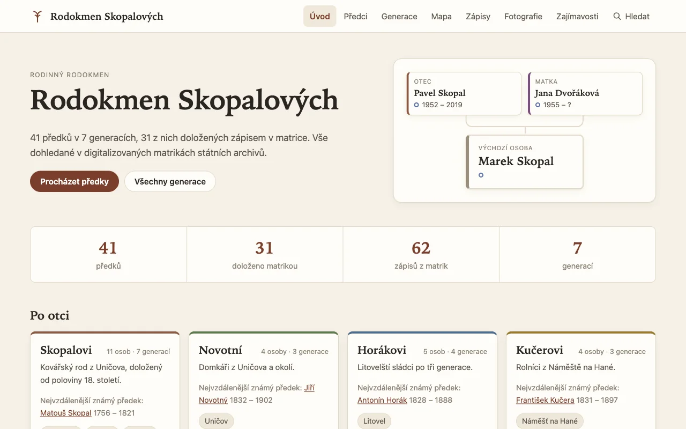
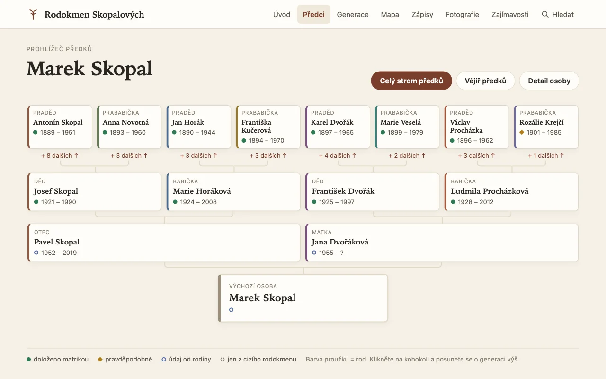
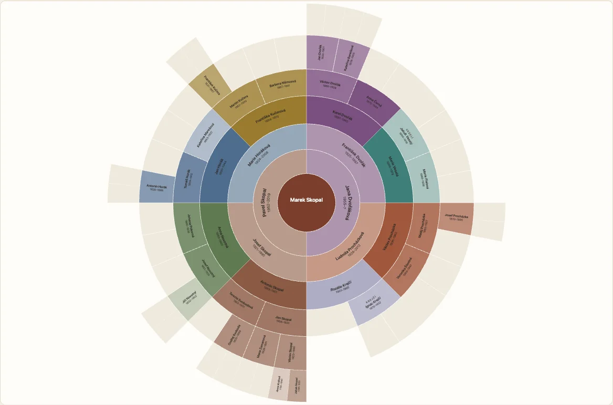
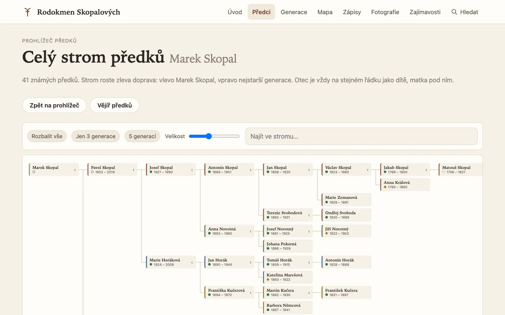
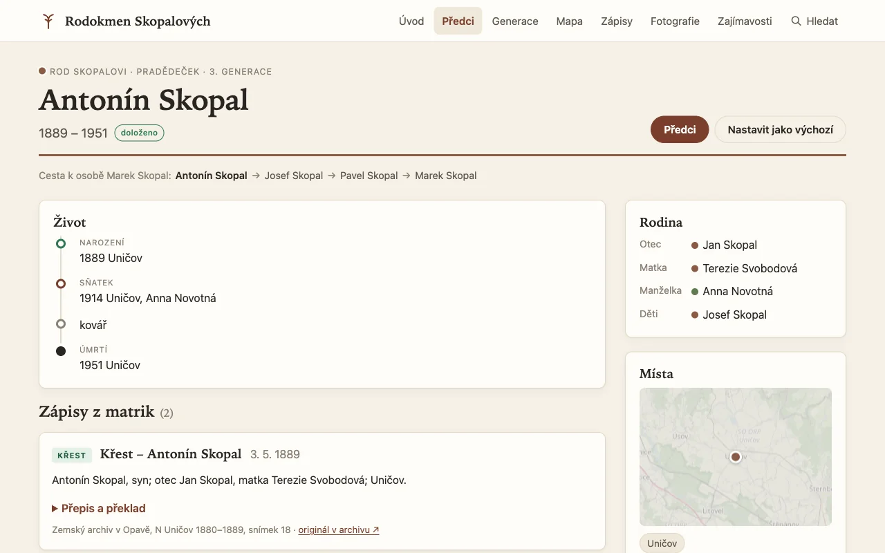
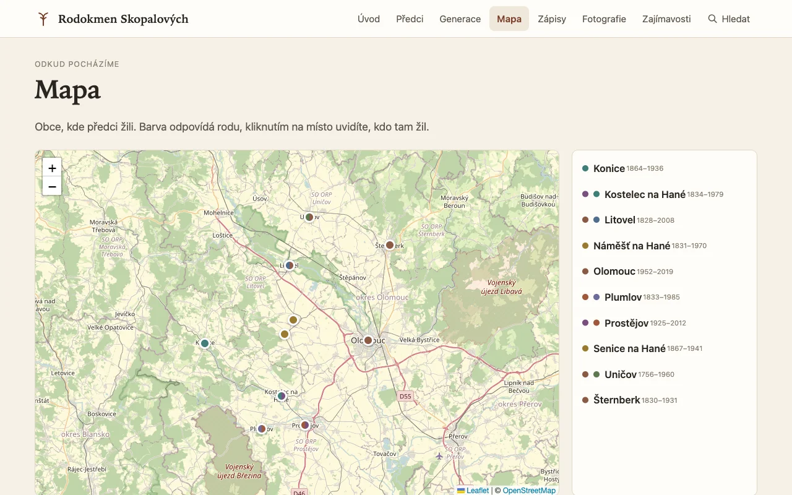
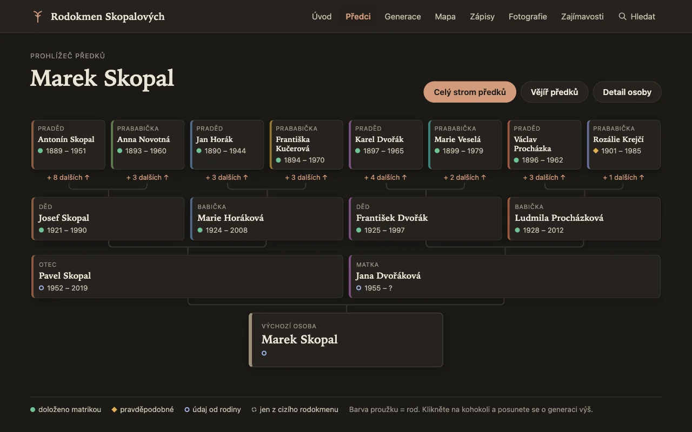

# rodokmen-web

A private, password-protected family tree website for genealogy projects made with the Claude Code skill
**[rodokmen](https://github.com/sarsonj/rodokmen-skill)** – the skill that researches your ancestors in the
digitised Czech parish registers and keeps every fact backed by a register entry.

The skill ships its own static website (Astro). rodokmen-web is an alternative for those who want to host the
tree themselves on any PHP server or in Docker: everything – pages, register scans, family photos – is shown only
after logging in, and new research is published with one command, without rebuilding or redeploying the site.

The user interface is in Czech, like the skill.

## Features

- **Password-only login** for the family (no user accounts). The password is stored only as a hash, the login is
  a signed cookie, repeated wrong attempts are throttled – per address (an IPv6 /64 counts as one) and, against
  guesses from many addresses, for all visitors together; browsers that have logged in before are not stopped by
  that shared limit (only by their own limit per device), so an attack cannot lock the family out.
- **Everything is private** – scans and photos live outside the web root and are streamed only to logged-in
  visitors; pages load smaller WebP copies sized to the screen (`srcset`), made on the server and cached.
- **Ancestor explorer** (`/predci`): one person in focus with three generations of ancestors, click anyone to move
  up. Every visitor can choose their own starting person (remembered in a cookie).
- **Full tree** (`/strom`) drawn left to right with collapsible branches, and a **360° fan chart** (`/vejir`) with
  zoom, pan and search.
- **Person pages** with a life timeline, family, siblings, places on a map, every register entry with the
  highlighted crop of the scan, transcription and translation, and family photos. Scans and photos open in a
  viewer with zoom and pan (mouse wheel, pinch, drag) in full resolution.
- **Generations**, **map** of places (Leaflet, bundled; map tiles from OpenStreetMap), **register entries**, **photos and documents**, **stories**,
  **research log**, **open questions** and **search**.
- **GEDCOM export** of the whole tree (GEDCOM 5.5.1) with the register entries as sources, for other genealogy
  software.
- **Ancestor poster** for printing or a print shop: a person's ancestors as a fan, a half fan, a tree or a painted tree on one sheet from A4
  to A0, in a simple or a historical style, saved as PDF in the browser at the right paper size or downloaded as SVG.
- **Print and PDF**: a numbered list of a person's ancestors (vývod) with their facts and register entries, and
  print-friendly person pages (the browser's Save as PDF).
- HTTPS only with HSTS, a strict Content-Security-Policy and the other security headers; responsive, dark mode.

## Screenshots

The demo family (`make demo`): the author's name, everything else – people, dates, register entries, stories – is
invented.

| | |
|---|---|
|  |  |
| Home page with the lines of the family | Ancestor explorer: one person and three generations above |
|  |  |
| 360° fan chart | Full tree, left to right |
|  |  |
| Person: life, family, register entries, places | Map of the places, coloured by line |



## How the data get to the website

The research project (made by the skill) and the website are separate: the website never needs access to your
research repository. The skill's exporter (`tools/export_web.py`) turns `data/*` into `site.json`, notes and
images; `bin/rodokmen-sync` packs them into a **data bundle** and publishes it:

```
rodokmen project ──tools/export_web.py──▶ site.json, notes, crops, scans
                 ──bin/rodokmen-sync────▶ bundle (manifest.json with SHA-256 of every file)
                                          ├─▶ https://your-site/api/sync/*   upload API (token)
                                          ├─▶ user@server:/path/var/data     rsync over SSH
                                          └─▶ ../rodokmen-web/var/data       local folder
```

Only changed files are sent. With the API, the server builds a complete new release next to the current one
(unchanged files are hard-linked) and switches to it atomically, so visitors never see half-uploaded data;
the previous release is kept, and `rodokmen-sync --rollback` switches the website back to it.

The bundle format (`manifest.json`, `format: 1`) is the contract between the two sides. It allows only
`site.json`, `md/*.md`, `img/*.jpg` and `full/*.jpg`; the server rejects anything else.

### Publishing from your project

`bin/rodokmen-sync` needs only Python 3.9+ (already required by the skill); the SSH target also needs `rsync`.
Download it, or use it from a clone of this repository:

```sh
curl -fsSLO https://github.com/marekskopal/rodokmen-web/releases/latest/download/rodokmen-sync
```

In your rodokmen project folder create `rodokmen-web.env` (see `rodokmen-web.env.example`) and **add it to
`.gitignore`** – it holds the upload token:

```sh
RODOKMEN_WEB_TARGET=https://rodokmen.example.org
RODOKMEN_WEB_TOKEN=<the website's SITE_SYNC_TOKEN>
```

Then, after every round of research:

```sh
python3 rodokmen-sync              # export + upload
python3 rodokmen-sync --dry-run    # only show what would be sent
python3 rodokmen-sync --no-export  # publish the last export as it is
python3 rodokmen-sync --jobs 8     # more parallel uploads (default 4)
python3 rodokmen-sync --rollback   # show the data of the previous upload again (API only)
python3 rodokmen-sync --help
```

Uploads to the API run in parallel, and every request is retried a few times (2, 4, 8, 16 s apart, or as the server's
`Retry-After` says) after a lost connection, a timeout or a temporary server error (HTTP 429, 500, 502, 503, 504).
Files already uploaded stay on the server, so running the command again after a failure sends only the rest.

Options `--target` and `--token` and the environment variables `RODOKMEN_WEB_TARGET` / `RODOKMEN_WEB_TOKEN`
override the file. Targets: `https://…` (API), `user@host:/path` or `ssh://user@host:port/path` (rsync over SSH),
anything else is a local folder.

## Installation

### Docker

Every release is published as the image `ghcr.io/marekskopal/rodokmen-web` (amd64 and arm64, e.g. a Raspberry Pi
or a NAS; tags `X.Y.Z`, `X.Y`, `X` and `latest`), based on `php:8.5-apache`. TLS is expected to be terminated by a
reverse proxy in front of the container, which listens on plain HTTP (port 8080 on localhost in
`docker-compose.yml`).

```sh
git clone https://github.com/marekskopal/rodokmen-web.git && cd rodokmen-web
cp .env.example .env           # set SITE_PASSWORD_HASH, SITE_SECRET and SITE_SYNC_TOKEN (see below)
docker compose up -d           # pulls ghcr.io/marekskopal/rodokmen-web:1
```

`docker-compose.yml` follows the major version (`:1`), so updates within it need no other change. To build the image
from the checkout instead (e.g. with your own changes), run `docker compose up -d --build`.

The data live in `./var` (mounted into the container), not in the image. Upload them with `rodokmen-sync` –
no restart is needed. Logs are in `./log` (Tracy's `error.log`, `warning.log`, `info.log` and exception
reports, `php-error.log`) and in `docker compose logs`. Tracy's log files larger than 10 MB are renamed to
`*.log.1` (three older copies are kept; `php-error.log` is written by PHP itself and is not rotated), exception
reports older than 30 days are removed, and the container log is limited to 3 × 10 MB. `docker compose ps` shows
the container's health: the image checks `/health` (no login needed, it tells only that the website runs) every
30 seconds.

Updating the website: `git pull && docker compose pull && docker compose up -d`. What changed is in
[CHANGELOG.md](CHANGELOG.md).

### Apache without Docker

Requirements: PHP ≥ 8.5 with GD (JPEG and WebP; e.g. `php-gd`, optional – without it the pages load the full JPEGs)
and Composer, and for building the front-end libraries Node.js ≥ 20 with
[pnpm](https://pnpm.io) (`npm install --global pnpm`; only needed at installation, not at runtime). Point the
virtual host's `DocumentRoot` to `public/`, enable `mod_rewrite` and allow `.htaccess` (`AllowOverride All`), then:

```sh
composer install --no-dev
pnpm install --frozen-lockfile --prod   # Leaflet for the map (package.json), without the test tools
pnpm build                              # copies it into public/assets/vendor
cp .env.example .env                    # and make var/ writable by the web server
```

Run the same commands again after every `git pull`. Docker builds the libraries in the image itself.

### Configuration

Environment variables, or `.env` in the project root:

| Variable | Meaning |
|---|---|
| `SITE_PASSWORD_HASH` | Hash of the site password – `php bin/hash-password.php`. Put it in **single quotes** (it contains `$`). |
| `SITE_SECRET` | Random secret for signing the login cookie (≥ 32 characters) – `php -r 'echo bin2hex(random_bytes(32)), PHP_EOL;'` |
| `SITE_SYNC_TOKEN` | Token of the upload API for `rodokmen-sync`; empty disables the API (use rsync then). Generate it like the secret. |
| `SITE_DEFAULT_PERSON` | Optional slug of the default starting person (default: the root of the tree). |
| `SITE_SEARCH_HINT` | Optional example in the search field, e.g. `Např. Novák, Lomnice, tesař…`. |
| `SITE_TRUSTED_PROXIES` | Reverse proxies in front of the website: IP addresses or CIDR ranges separated by commas, `private` for loopback and private networks (a proxy on the same machine or in Docker; the Docker image's default). Only requests coming from them may set `X-Forwarded-Proto` (HTTPS) and `X-Forwarded-For` (the client's address for the login throttle and the logs); the header is read from the right, so entries a client forged are ignored. Empty (default outside Docker) = no proxy. The older `SITE_TRUST_PROXY=1` still works and means `private`. |
| `SITE_LOGIN_DAYS` | How long a login stays valid (default 30). |
| `SITE_FORCE_HTTPS` | `1` (default) redirects HTTP to HTTPS and sends HSTS; `0` only for a site without TLS. `localhost` is never redirected. |
| `SITE_LOG_LEVEL` | `production` (default) or `debug` (also debug records). |
| `SITE_LOG_DIR` | Log folder (default `log/`). [Tracy](https://tracy.nette.org) writes `error.log`, `warning.log` (failed logins), `info.log` (data uploads), `critical.log` and an HTML report `error--*.html` for every exception. |
| `SITE_LOG_STDERR` | `1` (default) also copies every record to stderr – Apache's error log, the container log in Docker. |
| `SITE_DATA_DIR`, `SITE_CACHE_DIR` | Data and cache folders (default `var/data`, `var/cache`). The upload API keeps its releases next to the data folder. |

The site title, footer, contact and the texts come from the project's `data/web.json` and data, through the
export. Changing the password or the secret logs everybody out.

## Development

```sh
make install                # composer install + pnpm install + pnpm build
python3 bin/rodokmen-sync -p ../my-rodokmen --target var/data
cp .env.example .env        # set SITE_PASSWORD_HASH and SITE_SECRET
make dev                    # http://localhost:8080
make demo                   # the demo family on http://localhost:8081, password: demo
make check                  # phpcs + phpstan + phpunit + tests of the sync client + Vitest
make test-e2e               # end-to-end tests in Chromium (Playwright) on the demo family
make fix                    # phpcbf
```

Front-end tests: `tests/js` are unit tests of the browser scripts in `public/assets` (Vitest; every test loads the
scripts into its own jsdom window), `tests/e2e` are end-to-end tests (Playwright) against `make e2e-server`, the
demo family on http://localhost:8090 with fresh data in `var/e2e`. Before the first run install the browser with
`pnpm exec playwright install chromium`. Every end-to-end test fails on a console error or a CSP violation.

A small PHP application without a framework or a JavaScript bundler (pnpm only copies Leaflet into
`public/assets/vendor`): one front controller, routes declared with PHP
attributes via [marekskopal/router](https://github.com/marekskopal/router), plain PHP templates, plain CSS and JS.

```
public/            web root: index.php, .htaccess, assets/ (assets/vendor is built by pnpm)
src/
├── Kernel.php     bootstrap: config, container, attribute routes, middleware, error pages
├── Config.php     settings from environment variables / .env
├── Auth/          password check, signed login cookie, login throttling
├── Http/          authentication middleware, HTTPS redirect and security headers
├── Logger/        Tracy logging behind PSR-3 LoggerInterface
├── Data/          Repository (read-only access to site.json) and readonly models
├── Sync/          data bundle manifest and the store behind the upload API
├── View/          template rendering, HTML helpers, fan chart
└── Controller/    pages, images, login and the sync API
templates/         PHP templates
bin/               rodokmen-sync (Python), hash-password.php, dev-router.php, build-assets.mjs
tests/             PHPUnit tests (fixture data in tests/Support/Fixture.php), tests/client for rodokmen-sync,
                   tests/js (Vitest) and tests/e2e (Playwright) for the front end
```

Code style: PHP_CodeSniffer with the Slevomat standard (tabs), PHPStan at level max with strict rules, readonly
models instead of arrays. The exported data are read through `ArrayReader`, which checks every type, so an
exporter change that breaks the format fails loudly instead of rendering wrong pages.

Contributions are welcome – see [CONTRIBUTING.md](CONTRIBUTING.md); security issues: [SECURITY.md](SECURITY.md).

## License

[MIT](LICENSE)
